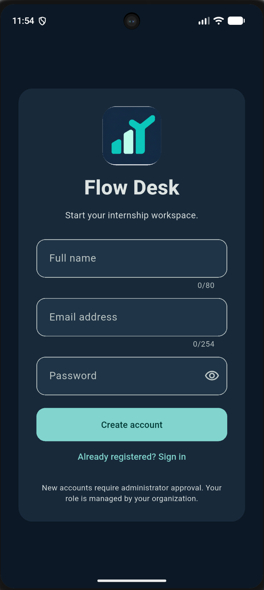
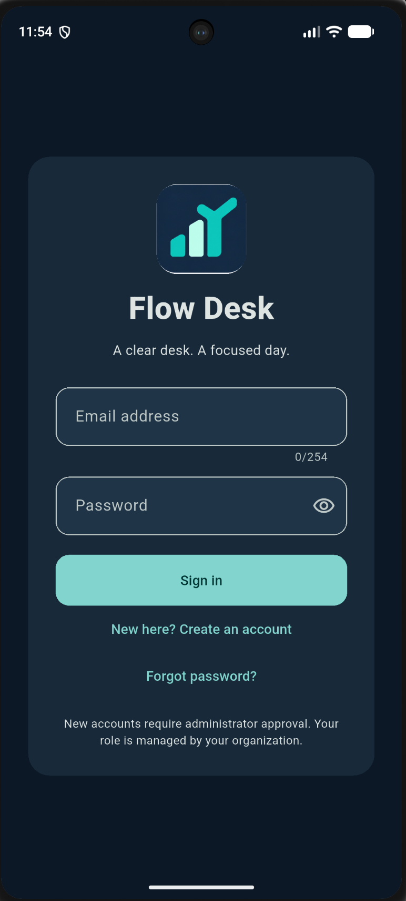
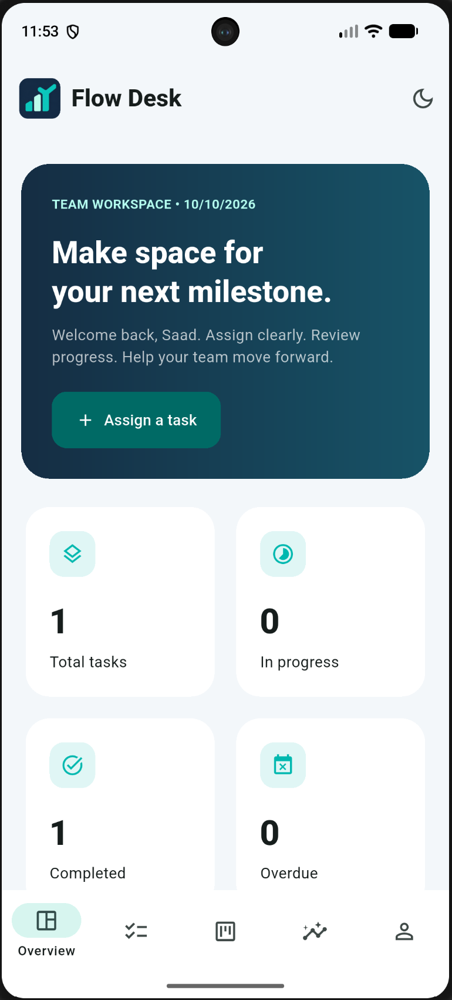
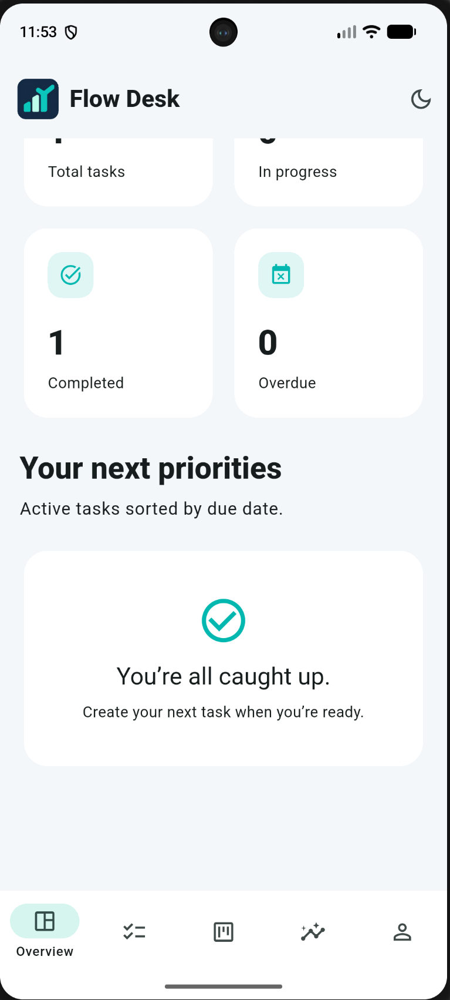
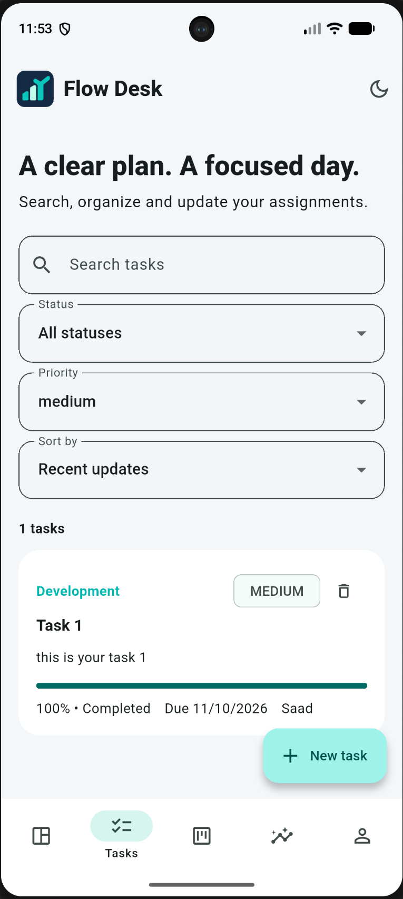
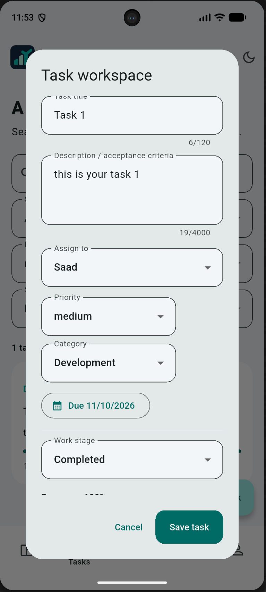
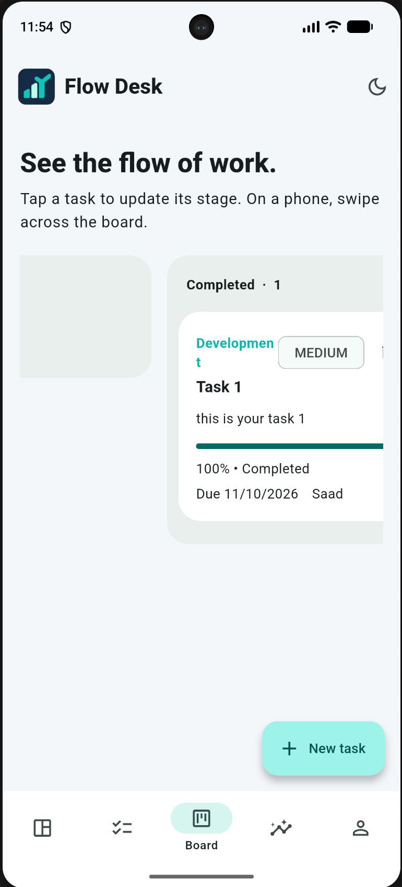
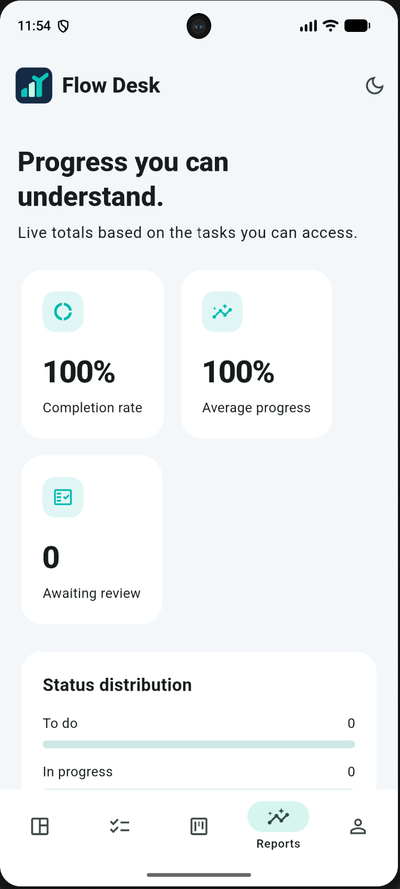
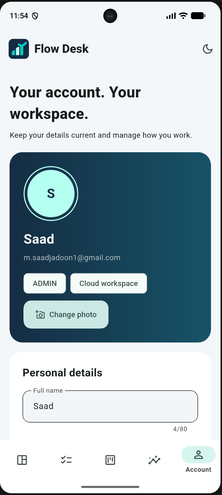
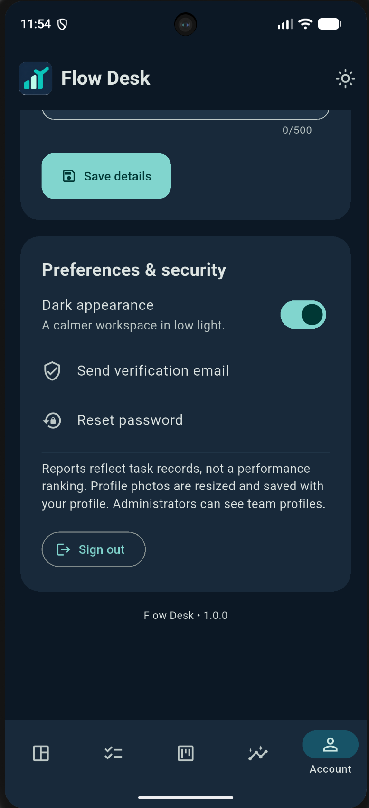

<div align="center">


# Flow Desk
### A clear desk. A focused day.

A Flutter workspace for assignments, team progress and administrator reviews.


[Screen tour](#screen-tour) · [Run locally](#1-run-the-app-immediately-in-demo-mode) · [Firebase setup](#2-connect-the-required-firebase-database) · [Verification](#verification-commands)
</div>

## Built around the way a team works

Create a task, assign it to an approved team member, track its progress and review the result in one workspace. Intern and administrator permissions are enforced by Firestore rules, with a local demo available for exploring the interface before cloud setup.

| Organize | Collaborate | Review |
| :--- | :--- | :--- |
| Search, category and priority filters | Assign and reassign work | Completion review and notes |
| Due dates and progress tracking | Realtime task updates | Status and overdue summaries |
| Four-stage Kanban board | Account approval and suspension | Team reports and CSV sharing |

Editable profiles, gallery photos, light and dark appearance, email verification and password reset complete the account workflow. No AI API or Python backend is required.

## Screen tour

Actual app screenshots supplied by the project owner, presented in the order of a typical workspace journey. Screens show different account/theme states; they are not a single uninterrupted session. All ten original PNGs are included at full resolution.

### 01 · Enter your workspace

<table>
<tr>
<th align="center">Create account</th>
<th align="center">Sign in</th>
</tr>
<tr>
<td align="center"><a href="docs/screenshots/01-create-account.png"></a></td>
<td align="center"><a href="docs/screenshots/02-sign-in.png"></a></td>
</tr>
</table>

### 02 · See the day ahead

<table>
<tr>
<th align="center">Workspace overview</th>
<th align="center">Daily priorities</th>
</tr>
<tr>
<td align="center"><a href="docs/screenshots/03-overview.png"></a></td>
<td align="center"><a href="docs/screenshots/04-priorities.png"></a></td>
</tr>
</table>

### 03 · Create and organize work

<table>
<tr>
<th align="center">Task workspace</th>
<th align="center">Task editor</th>
</tr>
<tr>
<td align="center"><a href="docs/screenshots/05-tasks.png"></a></td>
<td align="center"><a href="docs/screenshots/06-task-editor.png"></a></td>
</tr>
</table>

### 04 · Follow progress and review results

<table>
<tr>
<th align="center">Kanban board</th>
<th align="center">Progress reports</th>
</tr>
<tr>
<td align="center"><a href="docs/screenshots/07-board.png"></a></td>
<td align="center"><a href="docs/screenshots/08-reports.png"></a></td>
</tr>
</table>

### 05 · Make the workspace yours

<table>
<tr>
<th align="center">Editable profile</th>
<th align="center">Appearance & security</th>
</tr>
<tr>
<td align="center"><a href="docs/screenshots/09-profile.png"></a></td>
<td align="center"><a href="docs/screenshots/10-settings.png"></a></td>
</tr>
</table>

## Visual direction

Navy, teal and mint carry the supplied logo into rounded cards, clear status indicators and responsive navigation. Phones use bottom navigation, wider layouts use a navigation rail, and forms scroll above the keyboard. The Kanban board scrolls horizontally on compact screens.

## 1. Run the app immediately in demo mode

Install a current stable Flutter SDK, Android Studio and the Android SDK. Minimum project requirements are Flutter 3.35/Dart 3.9; use current stable if a dependency requires a newer SDK. Start an emulator in Android Studio Device Manager.

Extract this folder, then PowerShell:

```powershell
cd "D:\Flow Desk"
Set-ExecutionPolicy -Scope Process -ExecutionPolicy Bypass
.\scripts\bootstrap.ps1
flutter devices
flutter run -d YOUR_EMULATOR_ID --dart-define=DEMO=true
```

Use your actual extracted path and device ID. Demo mode needs no Firebase configuration. It starts with sample tasks and users, saves edits on this device and includes a Switch demo role button in the toolbar/account page. This is a simulation for UI evaluation, not live authentication or cross-device sync. The local demo account is separate from Firebase accounts.

For Chrome:

```powershell
flutter run -d chrome --dart-define=DEMO=true
```

Do not use `flutter run` without the DEMO define until Firebase is configured; the default is live mode and a setup screen is shown when Firebase initialization is missing.

## 2. Connect the required Firebase database

Use a NEW Firebase project for Flow Desk. Do not reuse the previous ResumeCraft database/rules; this app has different collections and permissions.

1. Firebase Console: create the Flow Desk project.
2. Enable Authentication → Sign-in method → Email/Password.
3. Create Cloud Firestore in production mode, choosing your preferred region.
4. Install Firebase CLI using Node.js: `npm install -g firebase-tools`.
5. Run these commands from the Flow Desk source folder:

```powershell
firebase login
dart pub global activate flutterfire_cli
flutterfire configure
```

Choose your Flow Desk project and Android/web (iOS needs macOS for builds). The command replaces `lib/firebase_options.dart` and generates platform configuration. Android's package is `com.saadi.flow_desk`; confirm it in `android/app/build.gradle.kts` and use that exact value for manual Firebase registration. If `flutterfire` is not recognized, add `%LOCALAPPDATA%\Pub\Cache\bin` to PATH and reopen the terminal, or run `dart pub global run flutterfire_cli:flutterfire configure`.

Deploy rules and the photo index exemption:

```powershell
firebase deploy --only firestore --project YOUR_FIREBASE_PROJECT_ID
flutter run -d YOUR_EMULATOR_ID
```

No Gemini key, REST server URL, `.env`, or Firebase Storage bucket is needed. Firebase client configuration is generated by FlutterFire. Never put service-account private keys in the app or repository.

## 3. Create the first administrator

Registration creates a **pending intern**, never an administrator. This is intentional: users cannot grant themselves access or an admin role.

1. Launch live mode and create your own account.
2. In Firebase Console → Firestore → `users` → your account UID document, change `role` to the string `admin` and `active` to the boolean `true`.
3. Return to the app. Its profile listener opens the admin workspace automatically; Refresh is also available.
4. Have interns register on their devices. In Reports → Team performance, approve them using the active switch.
5. Assign tasks to those approved accounts. Interns update progress and submit admin-assigned tasks as In review. Admins can add a review note, return a task to In progress or mark it Completed.

A user can complete/delete their own personal task. They cannot delete, reassign, edit the description of or approve an administrator-created assignment. Deactivated accounts lose task access. Admin role changes are console-controlled in this version. One Firebase project represents one organization's workspace; this is not a multi-tenant platform.

## Database explained

| Collection | Document ID | Stored information |
| --- | --- | --- |
| `users` | Firebase Auth UID | Name, email, role, approval flag, specialization, phone, bio and photo |
| `tasks` | UUID | Title, description, assignee UID, creator UID, due date, timestamps, status, category, priority, progress and review note |

Firestore listeners update screens in real time when connected. Native Firebase caching can show previously fetched records offline; write confirmation may wait for connectivity. Timed-out writes can still synchronize later, so check the task before repeating an action. Demo mode uses SharedPreferences and has no cloud connection.

Profile photos are picked from the gallery at up to 384px, compressed, limited to 145 KB before base64 encoding and stored in the user's Firestore document. Profile data is visible to that user and approved administrators, not other interns. The photo field is exempted from indexing. This approach is suitable for a small internship workspace; move avatars to object storage for a larger organization. Photos contribute to Firestore document reads/storage. Selection can be cancelled; oversized images are rejected. On Android, interrupted photo picking prompts the user to choose again after lost-data recovery.

Reports show task-derived metrics, not measured hours worked or an automatic performance ranking. Dates use device-local calendar days. Timestamps are client-supplied and are not a tamper-proof audit log. No background push/reminder service is included; overdue states appear inside the app.

## Verification commands

After bootstrap:

```powershell
.\scripts\verify.ps1
```

Or individually:

```powershell
flutter pub get
dart format lib test scripts
flutter analyze
flutter test
flutter build apk --debug --dart-define=DEMO=true
```

For the configured live app:

```powershell
flutter build apk --debug
flutter run -d YOUR_EMULATOR_ID
```

### Firestore authorization tests

Install Node.js 20+ and Java 21 for the Firebase emulator, then:

```powershell
npm ci --prefix tests/firestore
firebase emulators:exec --only firestore --project demo-flow-desk "npm --prefix tests/firestore test"
```

Tests cover unauthorized reads, pending membership, role escalation, assignee isolation, personal tasks, review approval and profile limits. The emulator tests use fake accounts and do not alter your production project.

### Manual acceptance check

Run live mode on two accounts/devices: admin and intern. Confirm signup approval, assignment arriving without restarting, progress arriving at admin, review notes, completion approval, intern inability to approve an admin task, profile photo persistence after restart, search/filters, dark appearance, reports and CSV sharing. Check on a narrow phone with keyboard open and at desktop width. Test loss/recovery of internet and an oversized photo.

See [VERIFICATION.md](VERIFICATION.md) for the exact checks executed during delivery. Flutter, Android builds and the Firebase emulator require local execution if they are unavailable in the delivery environment. No zero-error guarantee is made.

## Repository layout

- `lib/`: models, Firebase/local store, app screens and forms
- `test/`: model, persistence, authorization guard and responsive widget tests
- `tests/firestore/`: real Firestore rules emulator tests
- `scripts/`: native bootstrap, permissions and local verification
- `assets/logo.png`: supplied app logo
- `firestore.rules`: role/approval/assignment access enforcement
- `.github/workflows/checks.yml`: Flutter and Firestore emulator CI
- `docs/task-brief.png`: supplied internship requirements

Commit the generated native folders and `pubspec.lock` after your successful local setup for reproducible checkouts. Generated Firebase client identifiers are not server secrets, but review all staged files. Do not commit Admin keys, signing keys or device-local config. No software license was chosen on your behalf.

## Official references

- https://firebase.google.com/docs/flutter/setup
- https://firebase.google.com/docs/firestore/security/get-started
- https://pub.dev/packages/image_picker
